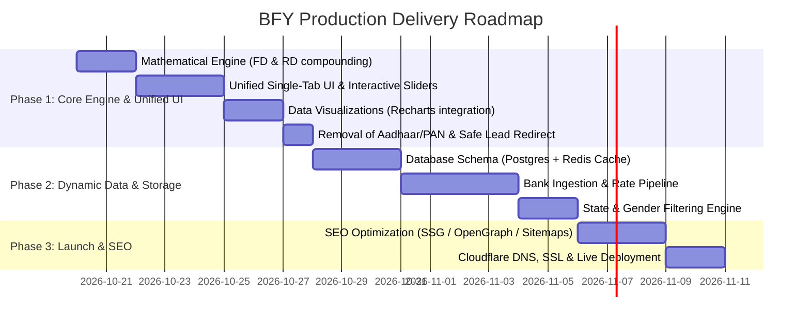

# Bharat Fixed Yield (BFY) — Production Readiness & Architecture Blueprint

> **Governing Principle**: Build the simplest production-quality solution that satisfies the current requirements, while making deliberate decisions about maintainability, security, performance, scalability, UX, and future change.

---

## 1. Executive Summary & Current Architecture Audit

Bharat Fixed Yield is designed to be an **RBI/DICGC-indexed yield comparison platform and calculator** for Indian fixed-income depositors (Fixed Deposits & Recurring Deposits).

### Current State (Prototype / Demo)
- **Frontend**: Vite + React 19 + Tailwind CSS v4 SPA.
- **Data Layer**: Hardcoded in-memory array (`src/data/bankData.ts`) with only 8 banks locked to 36-month tenures.
- **Backend / APIs**: No backend currently running (Express packages in `package.json` are unused; no endpoints exist).
- **Navigation Model**: Fractured UX where "Rate Finder & Calculator" and "Live Bank Comparisons" are separate tabs requiring cross-screen toggling.
- **Visuals**: Static CSS progress bars; no real interactive data visualization charts.

---

## 2. Issues & Technical Gaps to Fix Before Going Live

### A. Core Mathematical & Domain Calculation Flaws
1. **Broken Recurring Deposit (RD) Calculation**:
   - **Current Flaw**: In `src/utils/calculator.ts` and `src/components/CalculatorScreen.tsx`, selecting `depositType: 'RD'` still runs `calculateYield()`, which calculates single-lump-sum FD quarterly compound interest ($A = P(1 + r/400)^{4t}$).
   - **Indian Banking / RBI Standard**: An RD is a sequence of monthly installments $M$ over $n$ months, where each installment compounds quarterly until maturity:
     $$A = \sum_{k=1}^{n} M \left(1 + \frac{r}{400}\right)^{4 \times \frac{n - k + 1}{12}}$$
   - **UI Disconnect**: Total invested in an RD is $M \times n$. The UI must prompt for "Monthly Installment" rather than "Principal Deposit Sum" when in RD mode.
2. **Quarterly Compounding Standards**:
   - FD cumulative deposits compound every calendar quarter (March 31, June 30, September 30, December 31) under RBI Master Direction on Interest Rates.
   - Non-cumulative option (monthly/quarterly interest payout to savings accounts) must be calculated accurately at discounted monthly yields.
3. **Tax & TDS Logic (Section 194A, 80TTA, 80TTB, Form 15G/15H)**:
   - General Citizens: ₹40,000 threshold for TDS under Section 194A.
   - Senior Citizens: ₹50,000 threshold under Section 194A and Section 80TTB deduction.
   - Non-PAN deduction rate (20%) vs. linked PAN rate (10%).

---

### B. User Experience & Tab Unification
* **Main Motto Requirement**: *"User should get RD and FD calculators in one tab and Top RD and FD options available to them based on realtime data... in graphical representation."*
* **Fix Required**:
  - Replace the separate "Calculator" and "Comparisons" tabs with a single **Unified Yield Command Center**.
  - **Top Section**: Instant dual-mode (FD / RD) calculator controls (Principal/Monthly Installment slider, Tenure selector, Age, Gender, State).
  - **Middle Section**: **Rich Interactive Visualizations**:
    - **Principal vs. Wealth Gain**: Donut / Radial chart showing user investment vs. interest earnings.
    - **Maturity Growth Timeline**: Interactive line/area chart tracking cumulative balance over quarters/months.
    - **Top Bank Yield Comparison**: Horizontal bar chart comparing maturity yields across RBI-trusted institutions.
  - **Bottom Section**: Real-time **Leaderboard of Matching Banks** that reactively updates as inputs change, without page reloads.

---

### C. Personalization Engine: Age, Gender, and Location
1. **Age Tiers**:
   - General Depositors (<60 years): Standard Card Rate.
   - Senior Citizens (60–79 years): +0.50% statutory rate bonus.
   - Super Senior Citizens (80+ years): +0.75% to +0.80% in select banks (e.g., SBI, PNB, Indian Bank).
2. **Gender-Specific Offerings**:
   - Currently, `persona.gender` exists in state but has zero effect on calculations.
   - Needs inclusion of women-specific rate boosts (0.10% – 0.25% premium offered by specific banks) and central initiatives like **Mahila Samman Savings Certificate (MSSC)**.
3. **Location & State-Specific Bank Availability**:
   - Currently, `persona.state` does not filter banks.
   - Scheduled Urban Co-operative Banks (e.g., Saraswat Bank, SVC Bank, Cosmos Bank) and Regional Rural Banks (RRBs) are jurisdiction-specific.
   - The engine must filter rates by `bank.operatingStates.includes(user.state) || bank.isPanIndia`.

---

### D. Critical Compliance & Security Hazards
1. **Mock Aadhaar & PAN Collection in `BookingModal.tsx`**:
   - Collecting or handling Aadhaar numbers without a UIDAI license, Aadhaar Data Vault, and DPDP Act (Digital Personal Data Protection Act 2023) compliance carries penalties up to ₹250 Crores and criminal liability.
   - **Production Resolution**: As a yield comparator/aggregator, the app must **never store raw Aadhaar/PAN**.
   - **Permissible Models**:
     - **Verified Bank Redirection / Deep Linking**: Direct the user to the official netbanking/mobile banking portal of the selected bank.
     - **Branch Contact / Lead Generation**: Collect only verified Name, Mobile Number, and City with explicit digital consent.
     - **Licensed FinTech SDK**: Integrate authorized digital FD partners (e.g., Setu, Tartan, Finzly) that manage e-KYC compliance natively.

---

### E. Data Pipeline: Static Data to Real-Time Rates
* **Current Flaw**: 8 static banks hardcoded in a single file with one tenure (36 months).
* **Production Resolution**:
  - Structured schema storing multiple tenure buckets per bank:
    - 7 to 14 days, 15 to 45 days, 46 to 90 days, 91 to 179 days, 180 to 364 days.
    - 1 Year, Special Tenures (e.g., 400 days, 444 days, 555 days, 777 days).
    - 2 Years, 3 Years, 5 Years (Tax Saver 80C).
  - Background crawler / verification worker running daily to track rate card revisions from RBI Scheduled Banks.

---

## 3. Recommended Production Tech Stack

Designed for **maximum performance**, **sub-100ms response times**, **SEO indexing**, and **lowest operational cost**:

```
┌────────────────────────────────────────────────────────────────────────┐
│                          CLIENT BROWSER                                │
│        Next.js 15 Client (React 19) + Tailwind CSS v4 + Recharts       │
└───────────────────────────────────┬────────────────────────────────────┘
                                    │ HTTPS / Edge CDN
┌───────────────────────────────────▼────────────────────────────────────┐
│                  CLOUDFLARE EDGE / VERCEL PLATFORM                     │
│  - Edge Caching (stale-while-revalidate for public rate endpoints)     │
│  - SSR / SSG for Bank SEO Pages (e.g. /fd-rates/sbi, /fd-rates/hdfc)   │
│  - Serverless API Routes (/api/rates, /api/calculate)                  │
└───────────────────┬───────────────────────────────┬────────────────────┘
                    │                               │
       Fast Read    │                               │ Read / Fallback
   (<10ms Response) │                               │
                    ▼                               ▼
       ┌────────────────────────┐      ┌─────────────────────────┐
       │     UPSTASH REDIS      │      │   NEON / SUPABASE       │
       │   (Serverless Cache)   │      │ (Serverless PostgreSQL) │
       └────────────▲───────────┘      └────────────▲────────────┘
                    │                               │
                    └───────────────┬───────────────┘
                                    │ Daily Cron / Write
                       ┌────────────┴─────────────┐
                       │ RATE INGESTION WORKER    │
                       │ (GitHub Actions / Cron)  │
                       │ - Crawl Bank Rate Cards  │
                       │ - RBI Scheduled Registry │
                       └──────────────────────────┘
```

| Layer | Recommended Choice | Rationale & Trade-offs |
|---|---|---|
| **Framework** | **Next.js 15 (App Router)** or **Vite + SSR** | Aggregator sites rely heavily on organic search traffic (e.g., *"best 3-year FD rates today"*). SSR/SSG ensures optimal SEO, while client components deliver fluid interactive sliders. |
| **Styling** | **Tailwind CSS v4** | Retains existing design system, eliminates runtime CSS overhead, supports seamless light/dark mode. |
| **Visualizations** | **Recharts** | Declarative, SVG-based, responsive, accessible tooltips, and compatible with React 19. |
| **Database** | **Neon PostgreSQL** or **Supabase** | Serverless SQL database with relational integrity for complex tenure matrices, auto-pausing when idle. |
| **Cache Layer** | **Upstash Redis (Serverless)** | Sub-10ms response time for rate card reads. Low write frequency (rates change monthly) + high read frequency (thousands of queries daily). |
| **Ingestion Pipeline**| **Cloudflare Workers Cron** or **GitHub Actions** | Scheduled headless scrapers/crawlers targeting top scheduled banks without managing persistent VMs. |
| **Hosting & CDN** | **Vercel** + **Cloudflare DNS/WAF** | Free SSL, global Edge CDN caching, DDoS protection, zero infrastructure maintenance overhead. |

---

## 4. Cost-Effective Hosting & Budget Model

| Service | Tier / Plan | Estimated Monthly Cost |
|---|---|---|
| **Cloudflare** | Free (DNS, CDN, Global Edge Caching, SSL) | $0 / mo |
| **Vercel / Cloudflare Pages** | Hobby / Standard Free Tier | $0 / mo |
| **Neon PostgreSQL** | Free Tier (0.5 GB storage, 100k queries/mo) | $0 / mo |
| **Upstash Redis** | Free Tier (10,000 commands/day) | $0 / mo |
| **Ingestion Worker** | GitHub Actions (2,000 free minutes/mo) | $0 / mo |
| **Domain Name** | `.in` / `.com` registry | ~₹800 – ₹1,200 / year |
| **Total Starting Cost** | | **₹0 – ₹100 / month** |

*Note: This architecture scales automatically to 100,000+ monthly active users (MAU) before requiring transition to paid tiers (which remain under $25–$50/month).*

---

## 5. Phased Production Implementation Roadmap



### Next Immediate Action Items
1. Unify `CalculatorScreen.tsx` and `LeaderboardScreen.tsx` into a cohesive, single-tab interface.
2. Implement correct RD math alongside FD calculations with dynamic label switching.
3. Integrate Recharts to render Principal vs. Interest Donut charts and Tenure Compounding Area charts.
4. Replace insecure Aadhaar/PAN fields with compliant official bank redirection buttons.
